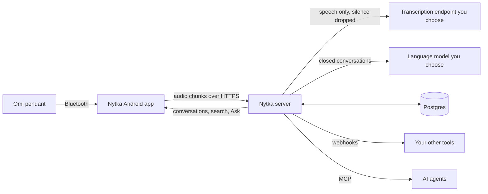

<!-- readme:header:start -->
<picture><source media="(prefers-color-scheme: dark)" srcset="https://raw.githubusercontent.com/Egoushka/Egoushka/main/assets/card-server-dark.svg"></picture>

<p>
  
  <a href="https://github.com/nytka-app/server/actions/workflows/ci.yml"></a>
  
</p>
<!-- readme:header:end -->

# Nytka server

> Self-hosted server for the Omi AI necklace: transcribes, summarizes and searches your recordings on a machine you run.

<!-- readme:status:start -->
**Parked**. It works; I am not changing it now and may come back.
<!-- readme:status:end -->



## Why

Omi is an open-source AI necklace that records the conversations around you. Its official app sends every
recording to Omi's cloud, and self-hosting that backend means Firebase, Google Cloud Storage, Pinecone, Redis and
OpenAI, with no Compose file. The free plan stops at 300 minutes and 30 questions a month. I wanted my recordings on
my own machine, with models I pick, and no quota. Nytka is the companion app and server that do that; this repository
is the server, [nytka-app/android](https://github.com/nytka-app/android) is the app. Why it is built this way:
[vision](docs/vision.md).

Facts as of 2026-10, checked against each project's own README or store listing. "Unknown" means the project's own
docs do not say.

| | Nytka | [Omi](https://github.com/BasedHardware/omi) (official app) | [Chronicle](https://github.com/SimpleOpenSoftware/chronicle) | [LocusTether](https://github.com/thecloudcowboy/locus-tether) |
|---|---|---|---|---|
| Self-host effort | Docker Compose | Firebase, Google Cloud Storage, Pinecone, Redis, OpenAI, no Compose file | Docker + MongoDB | CUDA, Docker, Ollama, Syncthing |
| Choose your models | any OpenAI-compatible endpoint | fixed providers with your keys | yes | Ollama only |
| Usage quotas | none | 300 min and 30 questions a month free | none | none |
| Offline sync from the pendant | yes | yes | unknown | no |
| Tags | yes | no | unknown | no |
| Raw audio export | yes | no | unknown | zip |
| TV and media kept out of people | yes | no | no | no |
| iOS | no | yes | yes | no |

## What it does

- **Transcripts without the silence.** The server drops silence with Silero VAD (a small voice-activity model), sends
  only speech to any OpenAI-compatible transcription endpoint, and groups the result into conversations.
- **Titles, summaries, tasks and memories.** With a language model you choose, each closed conversation gets a title,
  a summary and tasks, and lasting facts about you become memories. The summary can follow a template for a meeting, lecture,
  doctor's visit or call, which you can edit. A task you already have open joins it instead of
  repeating, and a near repeat waits in the review inbox ([duplicate tasks](docs/explanation/features.md#duplicate-tasks)).
- **People and your own voice.** It learns your voice, groups other voices, keeps facts about the people you talk to,
  and keeps the TV and phone calls out of them.
- **Search and Ask** over everything, in Ukrainian and English, plus a daily digest and briefs before calendar events.
  With an embeddings model and pgvector they also find by meaning, not only by the words you said
  ([vector search](docs/reference/configuration.md#vector-search)).
- **Webhooks and MCP.** Your other tools hear about new conversations, tasks and memories; AI agents read it all over
  MCP (Model Context Protocol, how AI tools read data) with 19 read tools and 3 that write.
- **Usage and a budget.** Each transcription request is priced by a table you can edit, `GET /api/v1/usage` shows
  the cost per day, the month so far and its forecast, and past a monthly budget batches go to a free engine and are
  marked to transcribe again, never dropped ([usage and budget](docs/specs/usage.md)).
- **Nothing is lost.** Audio the pendant stored while the phone was away arrives later at the time it was recorded, and
  an Omi export imports in one call. Nytka's own export reads back in, to restore a server or move to a new one
  ([restore](docs/how-to/install.md#restore-a-nytka-export)).

Not here: an iOS app, a hosted version for people who do not self-host, and OAuth sign-in for MCP clients. What each
milestone adds, and what comes next, is in the [roadmap](ROADMAP.md).

> [!WARNING]
> Nytka records the people around the wearer. You are responsible for following the recording and privacy laws where
> you use it. Nytka is an independent project, not affiliated with or endorsed by Based Hardware; "Omi" is a trademark
> of its owner.

## Quick start

On a Linux or macOS host with Docker. This writes `./nytka` with a generated admin token and Postgres password, and
starts Postgres, the server, a local speech-to-text server and a local language model, so it needs no account and no
API key. Local models are slower and less accurate than a hosted provider.

```bash
curl -fsSL https://raw.githubusercontent.com/nytka-app/server/main/scripts/install.sh | bash
curl http://127.0.0.1:8080/healthz
```

`healthz` answers `{"status":"healthy"}`. Then give the phone an HTTPS address and pair the app:
[Install the server](docs/how-to/install.md) walks through it, and through a hosted transcription account such as
Groq, step by step, in about 15 minutes.

To build from source instead: .NET 10 SDK and a Docker daemon (the tests start Postgres through Testcontainers).

```bash
dotnet build
dotnet test
```

## How it works

The app uploads the pendant's Opus audio in chunks of about 30 seconds. A processing run drops silence, stores the
speech and queues transcription; a conversation ends after two minutes without speech. Jobs run in three lanes so a
slow model or webhook receiver never delays transcription: audio, AI, and hooks.

The invariant that matters: **times are capture times.** The pendant stops sending in silence and Bluetooth drops
frames, so the server never turns a sample count into a time; audio pulled from the pendant's own storage carries its
recording times, and conversations form by them, not by arrival. Each processing run commits in one transaction, so a
crash repeats work and never loses or duplicates it. [Architecture](docs/guide/architecture.md) has the detail.

## Numbers

| | Value | Source |
|---|---|---|
| HTTP API routes | 82 | rows of the table in [API](docs/reference/api.md#api) |
| MCP tools | 21 (18 read, 3 write) | [MCP](docs/reference/api.md#mcp) |
| Database migrations | 32 | `db/migrations/` |
| Test methods | 1,391 | `[Fact]` and `[Theory]` in `tests/` |

## Docs

- [Install the server](docs/how-to/install.md): the 15-minute install, import from Omi, restoring a Nytka export, transcript and audio files
- [Configuration](docs/reference/configuration.md): every setting, tokens and scopes, QR pairing, transcription and
  language-model endpoints
- [HTTP API, webhooks and MCP](docs/reference/api.md): every route, webhook events and signing, the MCP tools
- [What Nytka does with a conversation](docs/explanation/features.md): your voice, people, tags, speech kinds,
  review, tasks, memories, export, digests, calendar, search, Ask
- [Run and maintain the server](docs/how-to/operations.md): what it stores, upgrading, offline sync, the no-loss
  wear test, testing without a pendant, building from source
- [Guide](docs/guide/index.md): the short guide the site publishes · [Vision](docs/vision.md) · specs per version in
  [docs/specs/](docs/specs/) · build plans in [docs/plans/](docs/plans/)
- [Roadmap](ROADMAP.md) · [Changelog](CHANGELOG.md) · [Contributing](CONTRIBUTING.md)

---

<sub>[Apache-2.0](LICENSE) · [Notice](NOTICE).</sub>
